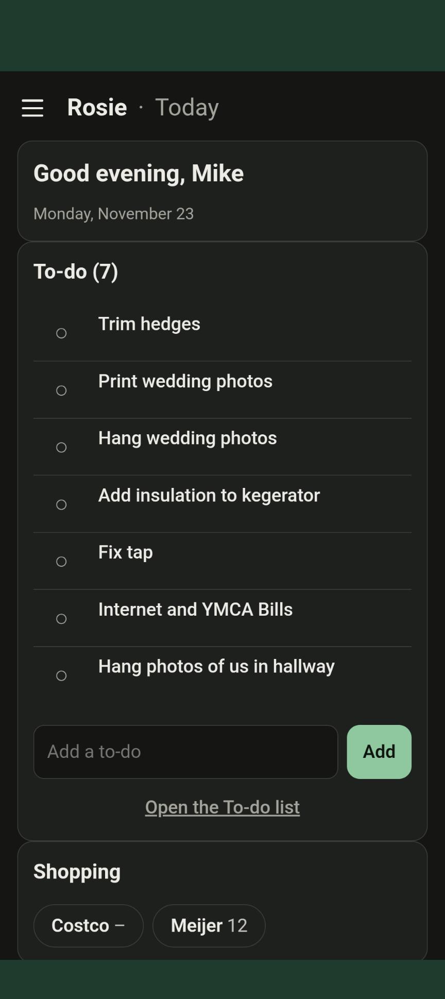
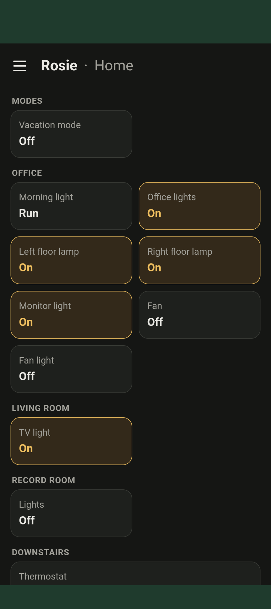
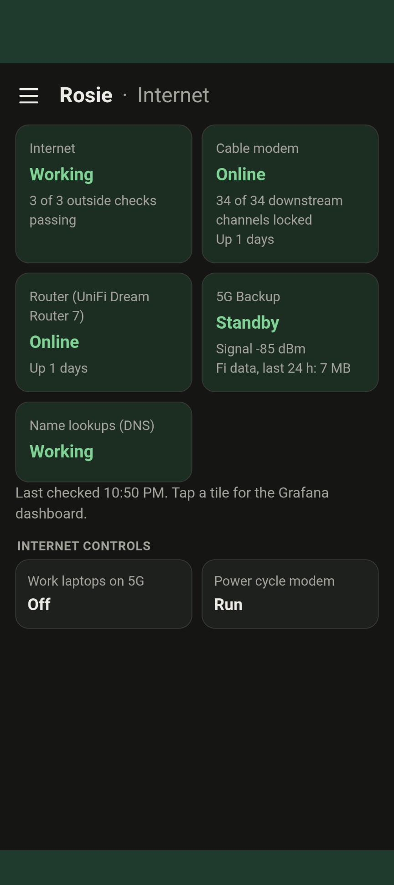
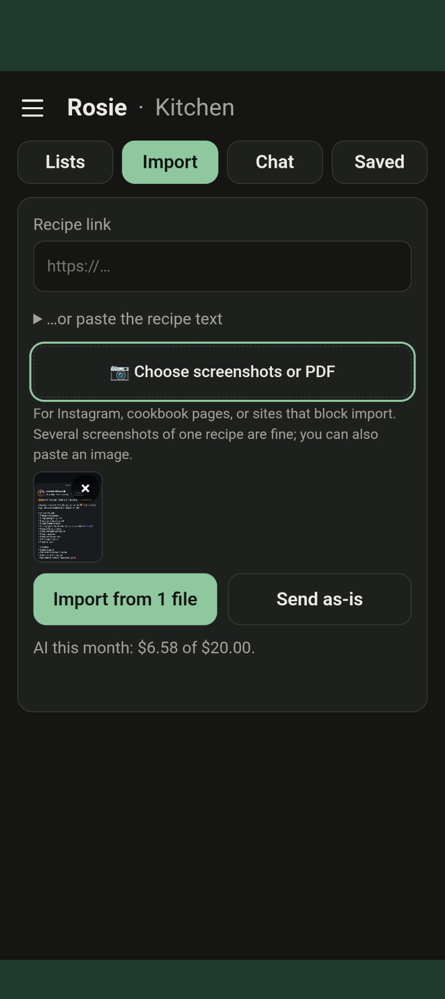
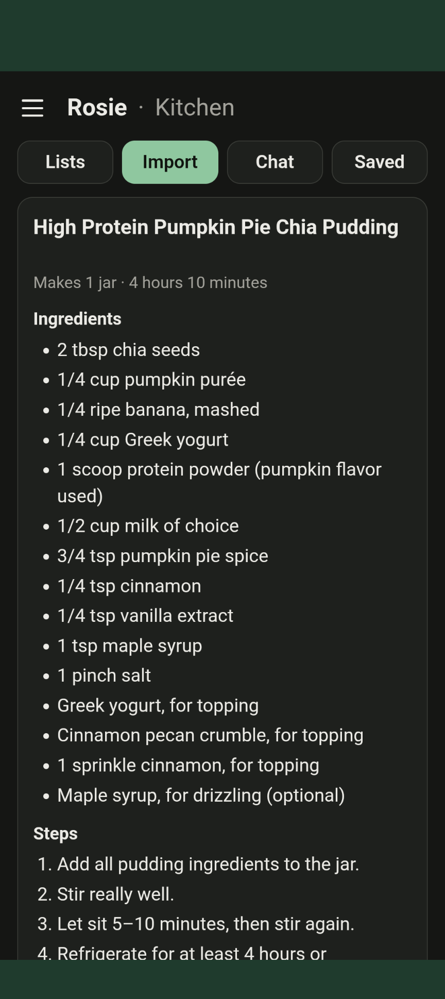
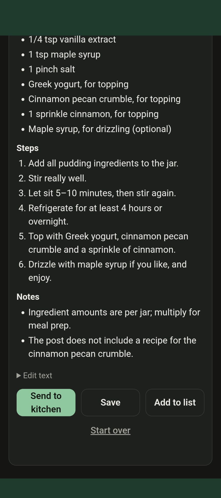

# Rosie

[](https://github.com/teixeiram/rosie/actions/workflows/ci.yml)
[](LICENSE)


Rosie is a self-hosted household app: one installable web app (PWA) for the
people in a home, instead of a different app for groceries, recipes, lights, the
thermostat, the internet connection and the family calendar.

It runs as a single Docker container on a Raspberry Pi, next to Home Assistant,
a Prometheus/Grafana monitoring stack and a Forgejo git server. It is reachable
only on the home network or over a VPN.

I built it for my own household. My family asked for features, I filed each one as an
issue, and every one shipped as a small reviewed pull request. That is why some
code comments mention issue numbers (`#5`, `#26`). Those numbers come from
the original private tracker, not from this repository.

<p align="center">
  
  
  
</p>
<p align="center"><em>Figure 1: Rosie on a phone, from left to right: Today, Home (Home Assistant tiles from my house's
configuration) and Internet (status from Prometheus, with the UniFi router and its 5G backup).</em></p>

## What it does

| Section | What you get |
|---|---|
| **Today** | Open to-dos, how many items are on each shopping list, and upcoming calendar events. |
| **Calendar** | Family calendars from Home Assistant, one color per calendar; multi-day events (like an on-call week) are tagged on every day. |
| **Kitchen** | Import a recipe from a link, pasted text, screenshots or a PDF. Claude extracts it into a fixed JSON schema, and you preview and edit it before saving. Chat with Claude about the saved collection ("what can I make with chicken thighs?"). *Send to kitchen* pushes a recipe to a kitchen display through a signed ntfy message. |
| **Lists** | Shared store and to-do lists that update live between phones. Items are grouped in each store's walking order and aisles are remembered. Any recipe can add its ingredients to a list. |
| **Internet** | Read-only tiles for the internet connection, cable modem, router and DNS, from Prometheus, with links to Grafana. |
| **Home** | Home Assistant tiles grouped by room (lights, fans, scripts, thermostat, status-only sensors). The app can only touch entities listed in [`home.toml`](home.toml). |
| **Developer** | Admin only. Browse and search issues from Forgejo repositories, and chat with Claude about one issue or the whole backlog. Claude can *draft* an issue or comment, but nothing is posted until a person presses the button and confirms. |

Every section is optional. If its settings are missing (no Home Assistant token, no
Anthropic key, no Prometheus), the section shows a "not set up" card and the rest of
the app keeps working.

## Tech stack

- **Backend:** Python 3.13, FastAPI, httpx, SQLite (WAL mode), Anthropic Python SDK
- **Frontend:** plain JavaScript, HTML and CSS. No build step. It has a service worker,
  so it installs on iOS and Android home screens and can receive links from the Android share sheet.
- **AI:** Claude Opus for recipe extraction and Claude Sonnet for recipe chat (both
  configurable). Answers are forced into a JSON schema, and every call is metered against a monthly budget.
- **Ops:** Docker Compose, Caddy (HTTPS reverse proxy), Prometheus blackbox probe and
  a container-down alert, pytest and ruff in CI

See [docs/architecture.md](docs/architecture.md) for a diagram of how it fits
into the rest of the home lab.

## Quick start (local, about 5 minutes)

You need Docker with Compose, or Python 3.13.

```sh
git clone https://github.com/teixeiram/rosie.git && cd rosie
cp .env.example .env
# For plain-http local testing, set ROSIE_COOKIE_SECURE=0 in .env.
# Optional: set ANTHROPIC_API_KEY to try recipe import and chat.
mkdir -p data
docker compose up -d --build
docker compose exec app python -m rosie.manage add-user alex "Alex" admin
```

Open <http://127.0.0.1:8098>. (`APP_PORT` in `.env` sets the port. Without a `.env` it
runs on 8199.) Sign in as `alex`.

Without Docker:

```sh
python3 -m venv .venv && .venv/bin/pip install -e '.[dev]'
.venv/bin/python -m rosie.manage add-user alex "Alex" admin   # uses ./data/rosie.db
ROSIE_COOKIE_SECURE=0 .venv/bin/uvicorn rosie.app:create_app --factory --port 8199
```

## Configuration

| File | Purpose |
|---|---|
| `.env` | Secrets and service URLs. Copy it from [`.env.example`](.env.example), where every setting is explained. Never commit it. |
| [`home.toml`](home.toml) | The allowlist of Home Assistant entities, and what each one may do (toggle, run, set a temperature range, or read only). |
| [`links.toml`](links.toml) | Links in the app menu. |
| [`branding.toml`](branding.toml) | The app's name, icons, colors and hostname. Renaming the app means editing only this file. |

## Usage examples

- **Import a recipe:** Kitchen → Import → paste a link, paste text, or choose
  screenshots or a PDF → **Import** → check the preview → **Save**, **Add to list** or
  **Send to kitchen**. On iPhone, a Shortcut can send links from Safari's share
  sheet. See [docs/share-to-rosie.md](docs/share-to-rosie.md).

  <p align="center">
    
    
    
  </p>
  <p align="center"><em>Figure 2: Importing a recipe from an Instagram screenshot. Claude
  extracts the recipe into a fixed structure and notes what the post left out. You review
  it before saving. The month's AI spend is shown against the cap.</em></p>
- **Shop:** Kitchen → a recipe → **Add to list**. In the store, Lists shows items in
  aisle order, and anyone else's phone updates as you check items off.
- **Manage accounts:** there is no sign-up page, on purpose.

  ```sh
  docker compose exec app python -m rosie.manage add-user <name> "<Display name>" member
  docker compose exec app python -m rosie.manage set-password <name>   # also signs them out everywhere
  docker compose exec app python -m rosie.manage list-users
  ```

## Security

Rosie can control the house and spend money on an API, so it is locked down on
purpose. [docs/security.md](docs/security.md) has the full threat model. In short:

- Accounts are created by the admin only. Passwords are hashed with scrypt. Sessions use an HttpOnly, Secure,
  SameSite=Strict cookie, and five wrong passwords lock that username for 15 minutes.
- Roles (`admin` and `member`) are checked on the server on every route.
- Recipe import fetches pages from the server, so every request is checked against
  private, loopback, link-local and VPN address ranges (an SSRF guard). The check runs again on every redirect and after connecting.
- Web pages and issue text are treated as untrusted data when sent to Claude
  (prompt-injection defense). Answers must match a JSON schema, and Claude can
  only *draft* actions; a person always confirms them.
- Home Assistant control is limited to the allowlist on the server. State-changing calls need a CSRF header and a
  same-origin check. The Content Security Policy blocks inline scripts.
- A monthly AI spending cap (`ROSIE_MONTHLY_CAP_USD`, default $20) stops imports
  once it is reached.

## Project layout

```
src/rosie/
  app.py            app factory, security headers, section loading
  auth.py           users, sessions, lockout
  config.py         settings from .env and the TOML files
  db.py             SQLite schema and migrations
  netfetch.py       SSRF-safe page fetching for recipe import
  recipe_ai.py      recipe extraction with Claude (JSON schema output)
  recipe_chat.py    chat over the recipe collection
  dev_chat.py       chat over Forgejo issues (drafts only)
  usage.py          API cost metering and the monthly cap
  sections/         one FastAPI router per section
  static/           the PWA: index.html, app.js, style.css, sw.js
tests/              pytest suite (HTTP-level tests with mocked services)
docs/               architecture, security, deployment, AI use
```

## Development

```sh
.venv/bin/pytest -q
.venv/bin/ruff check src tests && .venv/bin/ruff format --check src tests
```

See [CONTRIBUTING.md](CONTRIBUTING.md) for the workflow. For deploying behind a reverse proxy, see
[docs/deploy.md](docs/deploy.md).

## How this was built

I designed and built Rosie with an AI coding assistant (Claude Code). The
assistant and my own role in the work are described in [docs/ai-usage.md](docs/ai-usage.md).

## License

[MIT](LICENSE) © 2026 Michael Teixeira
