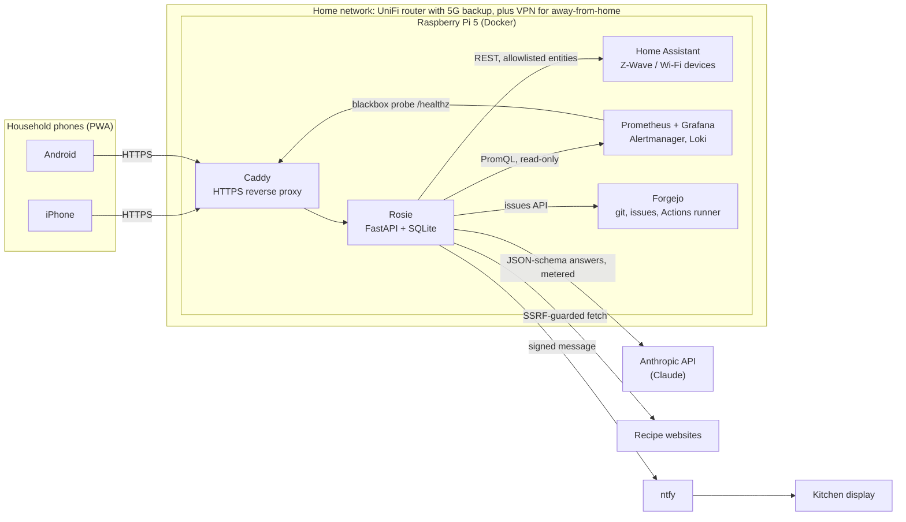
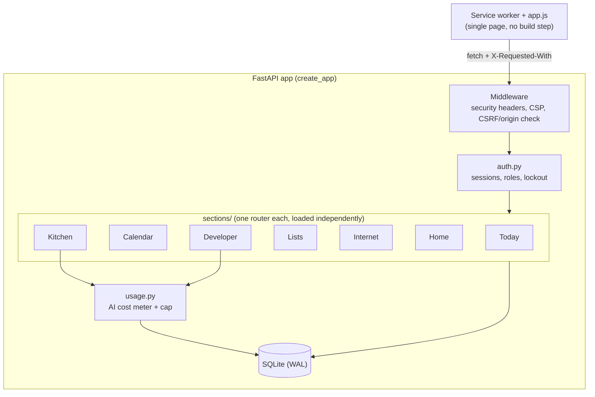

# Architecture

## Where Rosie sits in the home lab

Rosie is the household-facing front end of a small home lab. Most of the
information it shows comes from systems that were already running. Rosie
adds one login, one installable app, and strict limits on what each person can do.

*Figure 1: Rosie and the services it uses. Every arrow out of Rosie is optional and turns on only when its setting is present.*

| Integration | Direction | Why it is safe to expose to the household |
|---|---|---|
| Home Assistant | read + limited write | Only entities in `home.toml`, only the actions listed for each one, and only within the thermostat's min/max. Admin-only tiles are enforced on the server. |
| Prometheus | read only | Fixed queries in code. No user input reaches PromQL. |
| Forgejo | read, plus write after confirmation | Admin-only section. The token has the issue scope only. Writing is off unless `FORGEJO_WRITE=1`, and each post needs a click and a confirm. |
| Anthropic | outbound | A monthly budget cap and a per-call cost log. Untrusted text is wrapped and labelled as data. Answers must match a JSON schema. |
| Recipe websites | outbound | Public addresses on ports 80/443 only. The check runs before connecting, on every redirect, and against the connected socket. |

## Inside the app

*Figure 2: Request path inside Rosie.*

Design decisions worth calling out:

- **Sections fail independently.** `app.py` loads each section's router
  separately. If one fails to import or its upstream service is down, that
  section shows an error card and the others keep working. A household app has to
  survive Home Assistant being restarted.
- **No build step on the front end.** It is one `app.js` file, served with revalidation
  and a versioned URL, so phones never keep running stale code after a deploy.
- **Configuration as allowlists.** What the app may control lives in reviewed TOML
  files in git, not in a settings page. Changing what the house can do from a
  phone is a code change with history.
- **One-file rename.** The name, icons and hostname are only in `branding.toml`.
  Nothing in the database, API paths or container depends on the name.
- **SQLite on purpose.** One writer process, a handful of users, and backups by
  copying a directory. WAL mode keeps the live list updates quick.

## Delivery workflow

1. Each feature starts as an issue in Forgejo, under an epic issue that tracks the plan.
2. Each feature gets its own branch and pull request, and must pass pytest and ruff
   before it merges. This GitHub copy runs the same checks in GitHub Actions.
3. After review the PR is merged and deployed with `git pull && docker compose up -d --build`.
4. Prometheus probes `/healthz`, and an alert fires if the container disappears.
